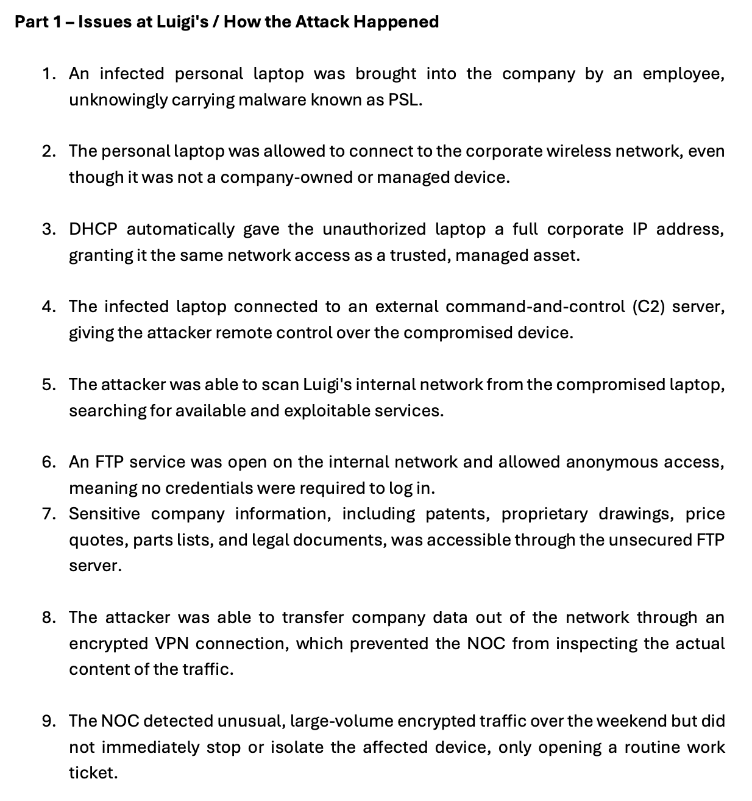
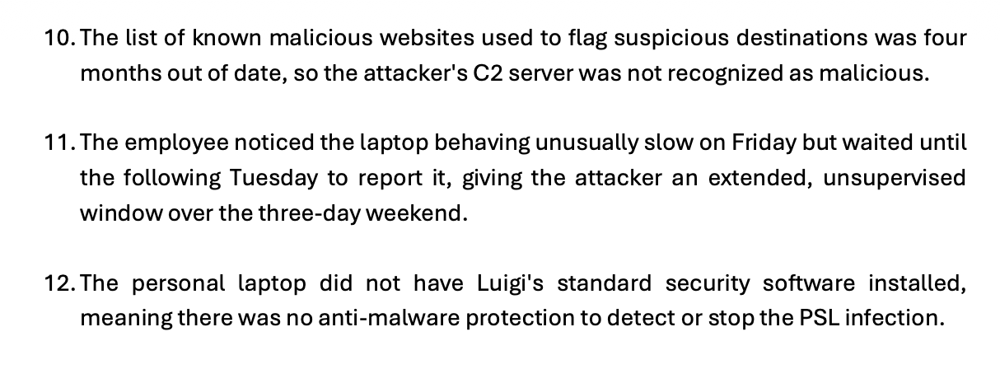
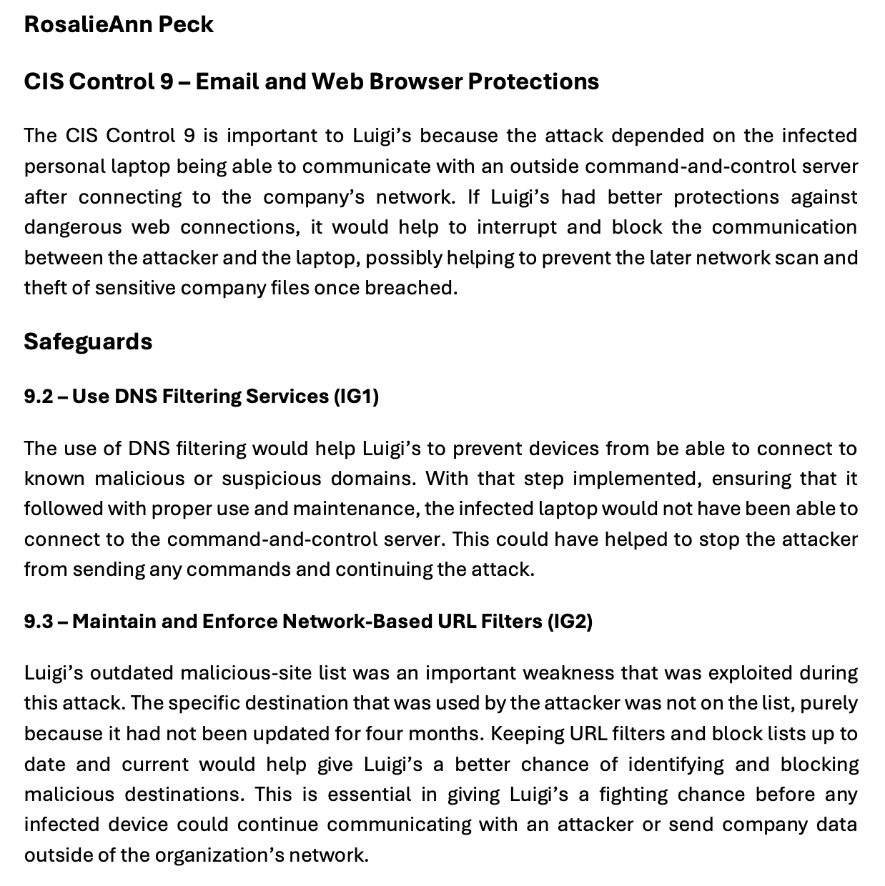
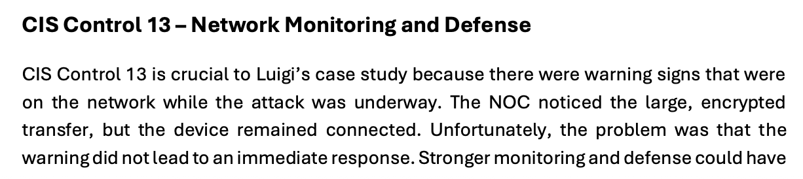
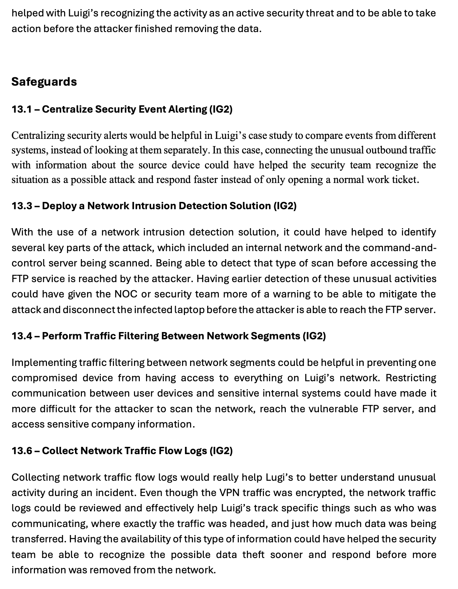
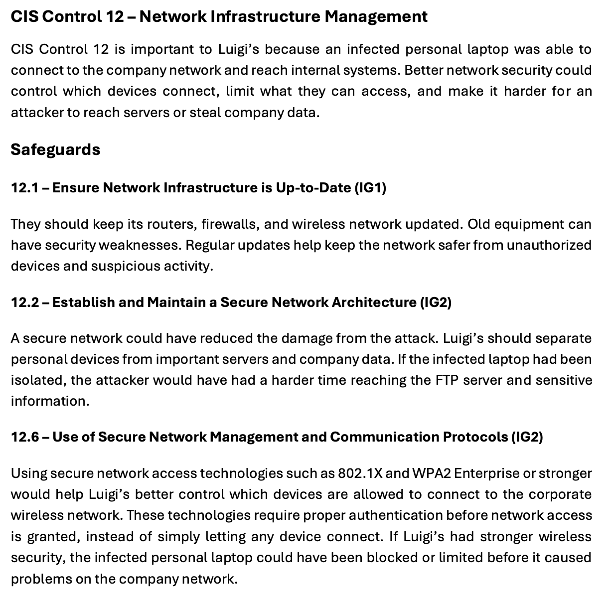

# CIS Controls & Security Risk Mitigation

## Project Overview

This project analyzed a simulated security incident involving an infected personal laptop that was allowed to connect to a corporate network.

The compromised device connected to an external command-and-control server, scanned the internal network, reached an unsecured FTP service, and contributed to the theft of sensitive company data.

The project focused on identifying weaknesses in the environment and mapping those weaknesses to CIS Controls and safeguards that could have reduced the likelihood or impact of the attack.

## Objectives

- Analyze how the attack progressed through the organization.
- Identify security weaknesses that allowed the compromise to continue.
- Apply CIS Controls to the incident.
- Evaluate safeguards for web protection, network infrastructure, and network monitoring.
- Recommend controls that could reduce command-and-control communication.
- Improve network segmentation and access control.
- Strengthen security monitoring and incident response.
- Reduce the risk of data exfiltration.

## Scenario Summary

The incident began when an employee brought an infected personal laptop into the organization.

The device was not company-owned or managed, but it was still allowed to connect to the corporate wireless network and received a full corporate IP address through DHCP.

The compromised laptop then connected to an external command-and-control server, allowing the attacker to control the system remotely.

*Attack scenario showing how an infected personal laptop gained corporate network access, connected to an external command-and-control server, scanned internal systems, and reached an unsecured FTP service.*

The attacker scanned the internal network, discovered an FTP service that allowed anonymous access, and gained access to sensitive company information.

The attacker later transferred company data out of the organization through an encrypted VPN connection.

Other weaknesses included delayed response by the NOC, an outdated malicious-site list, delayed reporting by the employee, and the lack of standard endpoint protection on the personal laptop.

*Continuation of the incident showing data exfiltration, delayed response, outdated malicious-site filtering, delayed user reporting, and the absence of standard endpoint protection.*

## CIS Control 9 — Email and Web Browser Protections

CIS Control 9 was applied because the attack depended on the compromised laptop being able to communicate with an external command-and-control server.

Improved web protection could have interrupted that communication before the attacker continued scanning the internal network and accessing sensitive systems.

### Safeguard 9.2 — Use DNS Filtering Services

DNS filtering could help prevent devices from connecting to known malicious or suspicious domains.

If the infected laptop had been prevented from reaching the attacker-controlled domain, the command-and-control connection could have been disrupted.

### Safeguard 9.3 — Maintain and Enforce Network-Based URL Filters

The organization relied on a malicious-site list that had not been updated for four months.

Maintaining current URL filters and block lists could have increased the likelihood of detecting and blocking the attacker's destination.

*Application of CIS Control 9 to the incident, focusing on DNS filtering and network-based URL filtering to disrupt command-and-control communication and reduce malicious web access.*

## CIS Control 13 — Network Monitoring and Defense

CIS Control 13 was applied because warning signs were visible while the attack was still underway.

The NOC detected unusual, large-volume encrypted traffic but did not immediately isolate the affected device.

Stronger monitoring and response processes could have helped identify the activity as an active security incident sooner.

*Application of CIS Control 13 to the incident, emphasizing stronger monitoring, alert correlation, and faster response.*

### Safeguard 13.1 — Centralize Security Event Alerting

Centralized alerting could allow the security team to correlate activity across multiple systems.

In this scenario, unusual outbound traffic combined with information about the source device could have helped the team recognize the compromise faster.

### Safeguard 13.3 — Deploy a Network Intrusion Detection Solution

A network intrusion detection solution could have helped detect internal scanning and suspicious communication with the command-and-control server.

Earlier detection could have provided the NOC with an opportunity to isolate the compromised laptop before the attacker reached the FTP service.

### Safeguard 13.4 — Perform Traffic Filtering Between Network Segments

Network segmentation and traffic filtering could have limited the ability of the compromised laptop to reach sensitive systems.

Restricting communication between user devices and internal servers could have made internal scanning and lateral access more difficult.

### Safeguard 13.6 — Collect Network Traffic Flow Logs

Traffic-flow logs could have provided useful information even though the exfiltration traffic was encrypted.

The security team could still review source and destination information, communication patterns, and the volume of transferred data.

*Recommended network-defense safeguards including centralized alerting, intrusion detection, segmentation, and traffic-flow logging.*

## CIS Control 12 — Network Infrastructure Management

CIS Control 12 was also applied because the infected personal laptop was able to connect to the corporate network and reach internal systems.

Improved network infrastructure management could help control which devices are allowed to connect and limit what those devices can access.

### Safeguard 12.1 — Ensure Network Infrastructure Is Up-to-Date

Routers, firewalls, and wireless infrastructure should be maintained and updated regularly.

Outdated network infrastructure can introduce security weaknesses that increase the likelihood of unauthorized access or suspicious activity.

### Safeguard 12.2 — Establish and Maintain a Secure Network Architecture

Separating personal devices from sensitive systems could have reduced the impact of the incident.

If the compromised laptop had been isolated on a restricted network segment, reaching the vulnerable FTP server would have been more difficult.

### Safeguard 12.6 — Use Secure Network Management and Communication Protocols

Secure access technologies such as 802.1X and WPA2 Enterprise or stronger can require authentication before access to the corporate wireless network is granted.

These controls could have helped prevent or restrict the infected personal laptop from receiving normal corporate network access.

*Application of CIS Control 12 to strengthen network infrastructure through secure architecture, updated network devices, segmentation, and authenticated wireless access.*

## Security Weaknesses Identified

The incident exposed several weaknesses:

- Unauthorized personal devices were allowed onto the corporate network.
- DHCP treated the personal laptop like a trusted corporate asset.
- The compromised device could communicate with an external C2 server.
- Internal network scanning was not stopped early.
- An FTP service allowed anonymous access.
- Sensitive company files were accessible through the FTP server.
- Network segmentation was insufficient.
- The malicious-site list was outdated.
- Security alerts did not lead to immediate containment.
- The personal laptop lacked the organization's standard anti-malware protection.
- User reporting was delayed.

## Recommended Improvements

Based on the control analysis, recommended improvements include:

- Implement DNS filtering.
- Maintain current URL and domain block lists.
- Centralize security event alerting.
- Deploy network intrusion detection.
- Segment user devices from sensitive servers.
- Filter traffic between network segments.
- Collect and review network traffic-flow logs.
- Keep network infrastructure updated.
- Require authenticated wireless access.
- Limit unmanaged or personal devices.
- Remove or secure unnecessary services such as anonymous FTP.
- Improve incident escalation and device-isolation procedures.

## Key Takeaways

This case study demonstrated how a single unmanaged endpoint can become the starting point for a much larger compromise.

The attack was not caused by only one weakness. It succeeded because several failures were combined, including weak access controls, insufficient network segmentation, outdated filtering, insecure services, limited monitoring, and delayed response.

The project reinforced the importance of layered security controls rather than relying on any single defensive measure.

## Skills Demonstrated

- CIS Controls analysis
- Security risk assessment
- Incident analysis
- Network defense
- DNS filtering concepts
- URL filtering concepts
- Network segmentation
- Intrusion detection concepts
- Security event alerting
- Network traffic analysis
- Access-control concepts
- Incident-response recommendations
- Technical documentation
- Security control mapping

## Lab Disclaimer

This project was completed as an authorized academic case study.

The scenario, systems, users, and incident details were used for educational purposes to evaluate security weaknesses and apply CIS Controls and safeguards.